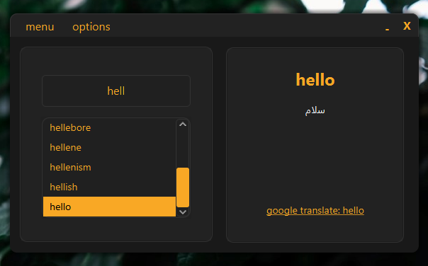

# About this project

Zen Dictionary was one of my collage projects built using JavaFx and Java 11. It’s a smart English-Persian and Persian-English Dictionary.

this is a project built with maven and you can import this in most of the IDES. I used [VSCode](https://code.visualstudio.com/docs/languages/java) for developing.

> [!WARNING] > **Note that entofa.csv and fatoen.csv files are required to exist in running directory for program to run properly!**

# Features

- Fantastic and custom made UI built with JavaFx and CSS
- Detecting language based on user input and auto translate to target language without needing to choose the language
- Suggesting words in a second
- Link for google translate
- Add , remove and update words using word manager by ease
- Bulk translate: good for translating paragraphs… I guess? (We had to use trees in such way OK? leave me alone!)
- Compressing using Huffman encoding (removed. Too slow!)
- Always on top mode
- Hunter mode: scan for new words in clipboard and auto translate them
- Translate word by hitting enter
- Smart save after any change in words

Note that this program is build in a short amount of time and could contain bugs so feel free to report them!

# Available commands

```bash
# Installation
mvn install

# Compile
mvn compile

# Run the application
mvn javafx:run

#  export to jar
mvn package
```
